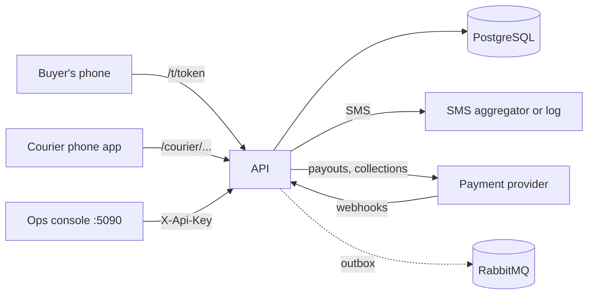
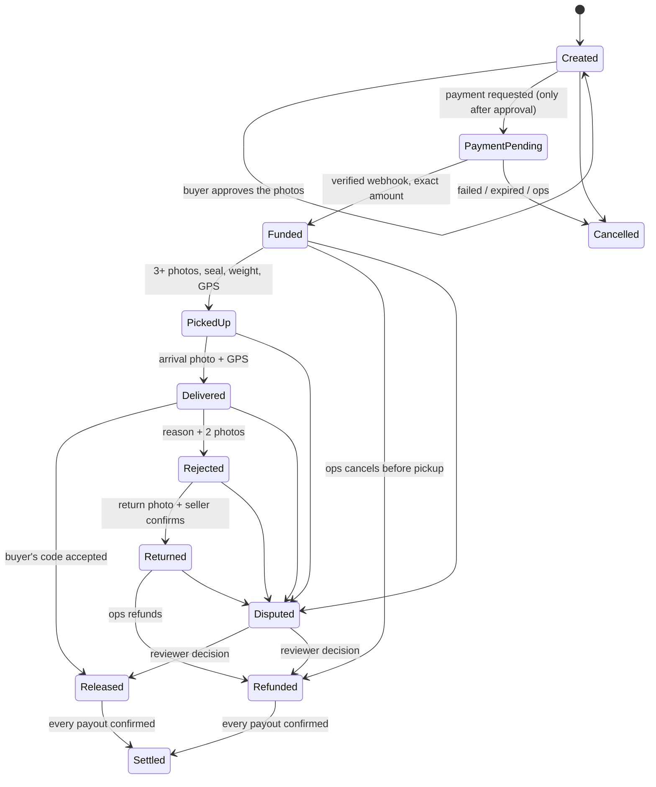

# Courier-Backed Escrow: Run It, Use It, Understand It

A trust layer for social-media and informal commerce in Malawi. The buyer pays into escrow, a courier acts as the
verifier at pickup and at the door, and the money is released only when the buyer gives the courier a one-time code.
Every kwacha is a ledger entry; nothing is ever edited, only posted.

This guide has three parts: **[run it](#1-run-it)**, **[use it](#2-use-it-walk-an-order-through)**, and
**[how it works](#3-how-it-works)**. Troubleshooting and the production checklist are at the end.

---

## 0. The pieces

| Piece | What it is | Who uses it | Address (development) |
|---|---|---|---|
| **API** (`CourierEscrow.Api`) | The engine: orders, payments, ledger, workers, webhooks | Everything else talks to it | http://localhost:5080 |
| **Ops console** (`CourierEscrow.Web`) | Blazor admin site | Ops agents, admins, finance | http://localhost:5090 |
| **Buyer page** | One page per order, opened from the buyer's link | The buyer | http://localhost:5080/t/`<token>` |
| **Courier app** | Phone web app (PWA) with an offline queue | Couriers | http://localhost:5080/courier-app/ |
| **PostgreSQL** | The database (ledger, orders, everything) | API | localhost:5432 |
| **RabbitMQ** (optional) | Receives domain events from the outbox | Other systems | localhost:5672 (UI 15672) |



The code is a **.NET 8 modular monolith** in four layers:

```
src/
  CourierEscrow.Domain/          The rules. Order state machine, ledger postings, OTP, settlement math. No dependencies.
  CourierEscrow.Application/     The use-cases (services) and the ports they need. No database or HTTP types.
  CourierEscrow.Infrastructure/  Postgres (EF Core), OneKhusa + mock provider, SMS, photo storage, workers, RabbitMQ.
  CourierEscrow.Api/             HTTP endpoints, auth, the buyer page and the courier app (wwwroot).
  CourierEscrow.Web/             The ops console (Blazor Server). A thin client of the API.
tests/
  CourierEscrow.Tests/           155 xunit tests (domain, services, provider adapter, security).
  courier-app/, buyer-page/      Node tests for the two browser apps.
scripts/demo.sh                  One order from start to SETTLED over HTTP.
```

Within each layer, files are grouped by responsibility: domain entities live in `Domain/Models`, API requests, response DTOs and mappings are in `Api/Contracts`, application ports are in `Application/Interfaces`, and console API models are in `Web/Models` while API client code stays in `Web/Services`.

---

## 1. Run it

### 1.1 You need

- **.NET 8 SDK** (`dotnet --version` should say 8.x)
- **Docker** (for PostgreSQL and RabbitMQ), or your own PostgreSQL 14+
- **Node 18+** only if you want to run the browser-app tests
- `curl` and `python3` only if you want `scripts/demo.sh`

### 1.2 First run (three terminals)

```bash
# Terminal 1: database (and RabbitMQ)
docker compose up -d

# Terminal 2: the API   ->  http://localhost:5080
dotnet run --project src/CourierEscrow.Api

# Terminal 3: the ops console   ->  http://localhost:5090
dotnet run --project src/CourierEscrow.Web
```

In **Development** (the default for both launch profiles) the system sets itself up:

- the database schema and the ledger guards are created on start (`Database:AutoInit`), and a demo courier is seeded
- the **mock payment provider** is used, so no real money or provider account is needed
- SMS messages are written to the API log (and to the console's "Test SMS inbox") instead of being sent
- throwaway keys and secrets from `appsettings.Development.json` are used
- the **dev endpoints** and the "Simulate ..." buttons are switched on

> **No RabbitMQ?** It is enabled in `appsettings.json`. If you did not start it, set `RabbitMq__Enabled=false`
> (or `"RabbitMq": { "Enabled": false }`). Nothing else depends on it.

### 1.3 Development logins and values

| What | Value |
|---|---|
| Console API key (set for you in Development) | `Api:Key` = `dev-admin-key` |
| Staff keys, sent as `X-Api-Key` | `dev-admin-key` (ops_admin), `dev-ops-key` (ops_agent), `dev-finance-key` (finance) |
| Seeded demo courier | phone `0999 123 456`, PIN `1234` (only created if there are no couriers yet) |
| Database | `Host=localhost;Port=5432;Database=courier_escrow;Username=postgres;Password=1234` |
| RabbitMQ UI | http://localhost:15672, `guest` / `guest` |

All of these are **throwaway, development only**. Never reuse them anywhere real.

### 1.4 Check it is alive

```bash
curl http://localhost:5080/health        # {"status":"ok"}
```

Then open http://localhost:5090. You should see the dashboard. The sun/moon button at the top switches between
light and dark; with no choice made it follows your device, and your choice is remembered.

### 1.5 Start over

```bash
docker compose down -v                   # removes the database volume
docker compose up -d
```

Restart the API and it recreates the schema. (Do this whenever you pull a version that changes the database in a way
the dev upgrade step does not cover.)

---

## 2. Use it: walk an order through

You can do this entirely in the browser, with no phone and no real payment.

### 2.1 Create the order (console)

1. **Couriers -> Add**: create a courier (or use the seeded demo courier).
2. **New order**: fill in the buyer, the seller, the courier, the item, the item price and the delivery fee.
   **Upload exactly three photos of the item.** The buyer will be asked to confirm them, so they must show the real item.
3. Save. The order is `Created`. Nothing has been charged and no payment has been requested.

### 2.2 The buyer approves the photos

The buyer receives an SMS with their link. In development, open the order in the console and click **Buyer link**
(it opens `http://localhost:5080/t/<token>`).

- The page shows the three photos and asks **"Is this the item you are buying?"**
- **Yes, this is the item** records the approval and **then** requests the payment. The page now shows the amount,
  the account to pay, a copy button and a 15-minute countdown.
- **No, this is not the item** needs a reason. No payment starts, the order is flagged for ops, and the buyer can still
  approve later.

> **The rule:** a payment can never be requested before the buyer has approved the photos. The API refuses with
> `422: The buyer must confirm the product photos before payment is requested.` The console only shows
> "Request payment" after approval.

In the console you can play the buyer's tap instead: **Simulate buyer approval** (dev).

### 2.3 Payment

In real life the buyer pays to the account shown and the provider calls the API's webhook. In development click
**Simulate payment** (on the buyer page's "Developer tools" or on the console order page). The order becomes `Funded`
and the ledger shows the money held in escrow.

### 2.4 Pickup, delivery, release

| Step | Real life | Development shortcut |
|---|---|---|
| Pickup | Courier photographs the item (3+), enters the seal ID and weight, GPS is captured | **Simulate courier pickup** |
| Buyer gets the code | 6-digit code by SMS | In the console's **Test SMS inbox** (or the API log) |
| Arrival | Courier takes an arrival photo at the door | **Simulate courier arrival** |
| Buyer inspects, gives the code | Courier types it into the app | **Simulate buyer accepting** (runs the real code check) |
| Payouts | Worker pays seller and courier through the provider | **Simulate success** on each payout in the console |

When every payout is confirmed the order becomes `Settled`. The order page shows the full timeline, evidence, ledger
and payouts the whole way.

### 2.5 Using the real courier app

Open http://localhost:5080/courier-app/ on a phone (or a phone-sized browser window), sign in with the courier's
phone and PIN. The first sign-in binds the account to that device; ops can reset the binding from the console.
Jobs appear when an order is `Funded`. The app works offline and syncs when the connection returns.

### 2.6 Everything at once

```bash
./scripts/demo.sh                 # one order, start to SETTLED, over HTTP
LOG=/path/to/api.log ./scripts/demo.sh   # reads the buyer's code from the log instead of asking you
```

### 2.7 Console pages

| Page | What it is for |
|---|---|
| **Dashboard** | "Needs attention" counts, where the money is, whether the books balance |
| **Orders** | Search and filter. "awaiting buyer" marks orders waiting for photo approval |
| **Order page** | Lifecycle, actions (cancel, refund, dispute, reissue code), evidence, ledger, payouts, test SMS inbox |
| **Payouts** | Every payout; retry the ones needing review (finance role) |
| **Disputes** | Open disputes with their 48-hour clock; decide with a written reason (admin role) |
| **Reconciliation** | Compare a selected day's payouts with the provider report, apply confirmed outcomes to the ledger, flag failures/reversals/mismatches, and check escrow balances. Runs daily after 02:00 UTC; Simulation mode notes that provider payout inquiry is unavailable. |
| **Couriers** | Add, suspend, reset a courier's device |

---

## 3. How it works

### 3.1 The order's life



Only the `Escrow` class in the Domain layer can change an order's state, and every change appends an immutable order
event. A released order can never be disputed.

### 3.2 The buyer's approval (the first gate)

1. The order is created with three listing photos.
2. The buyer opens their link. `GET /track/{token}` returns the photos and `canConfirmProduct: true`.
3. **Yes** calls `POST /track/{token}/confirm-product`. The server **commits the approval first**, then asks the payment
   provider for a payment request. If the provider is down, the approval is kept and the page shows
   *Get my payment details*; tapping it repeats the request with the **same reference**, so nobody is charged twice.
4. **No** calls `POST /track/{token}/decline-product` with a reason: no payment, the order is flagged for ops.

### 3.3 The money

Amounts are stored as whole **tambala** (1/100 kwacha) in a `long`. There is no floating point anywhere.
The platform fee (default 2%) is charged on the **item** price and is fixed on the order when it is created.

Worked example: item K300,000, delivery K8,000, fee 2% of the item.

| Event | Debit | Credit |
|---|---|---|
| Buyer pays | provider clearing 308,000 | escrow 308,000 |
| Code accepted | escrow 308,000 | seller payable 294,000, platform revenue 6,000, courier payable 8,000 |
| Rejected, returned, refunded | escrow 308,000 | buyer refundable 300,000, courier payable 8,000 |
| Payout confirmed | seller payable 294,000 (+ provider fee) | provider clearing |

The books balance when `provider balance = escrow + payables + platform revenue - provider fees`. The dashboard shows
this check and reconciliation enforces it. The database itself rejects any ledger transaction that does not balance,
and rejects UPDATE or DELETE on the ledger, order events and audit log.

### 3.4 The buyer's code (OTP)

When the courier picks up, a six-digit code is texted to the buyer. The buyer gives it to the courier **only after
inspecting the item**. The server stores only a keyed hash (never the code), the code expires after 24 hours, and five
wrong attempts lock it and flag the order for ops, who must verify the buyer and reissue it. A retried wrong attempt
is not counted twice.

### 3.5 Evidence

Photos are uploaded through a signed, expiring link. The **server** computes each photo's SHA-256, so a client cannot
lie about it. GPS and server time are stored with every proof. Accepted types are JPEG, PNG and WebP, up to 10 MB.

### 3.6 Payments and payouts

- **Collections:** the payment intent is saved *before* the provider is called and carries a stable reference used as
  the provider's idempotency key. The provider's webhook is verified (HMAC), stored raw first, de-duplicated, then
  applied. A wrong amount does not fund the order; it is flagged. A payment that arrives after cancellation is flagged
  for a manual refund, never swallowed. If a webhook is lost, polling asks the provider. If nobody pays within
  15 minutes, the order is cancelled.
- **Payouts:** a settlement creates one payout per payee. A worker submits them with stable keys and retries
  transient failures. Only a **confirmed** payout posts the ledger entry that clears the payable, and an order is
  `Settled` only when all of its payouts are confirmed. Payouts the provider refuses go to `NeedsReview`.

### 3.7 Disputes

Ops can open a dispute from any live state except `Released`. It freezes the money and starts a 48-hour clock. An admin
decides by splitting the escrowed amount between buyer, seller, courier and platform, with a written reason.

### 3.8 Background workers

They run inside the API when `Workers:Enabled` is true.

| Worker | Every | Does |
|---|---|---|
| Notification | 2 s | Sends queued SMS (the OTP is encrypted until sent, then blanked) |
| Webhook inbox | 3 s | Applies stored provider callbacks, retries failures |
| Payout | 5 s | Submits due payouts, polls submitted ones |
| Payment | 15 s | Expires unpaid orders, polls pending collections |
| Reconciliation | 10 min | Daily comparison with the provider |
| Outbox publisher | continuous | Sends domain events to RabbitMQ (if enabled) |

### 3.9 Who can do what

| Role | Can |
|---|---|
| `ops_agent` | Create orders, request payment, cancel, reissue codes, open disputes |
| `ops_admin` | Everything an agent can, plus refunds, decide disputes, manage couriers, read the audit log |
| `finance` | Retry payouts, run reconciliation, list provider connectors |
| courier | Sign in with phone + PIN (device-bound); only their own jobs; a signed token |
| buyer | Only their own tracking link (an unguessable token is the only credential) |

Phone numbers are masked in the admin API and logs. Couriers see full numbers only for their own jobs.

### 3.10 API map

```
Courier   POST /courier/login                      GET /courier/jobs[/{id}]
          POST /courier/uploads/presign            PUT /uploads/{id}?exp&sig   (signed link, photo bytes)
          POST /courier/orders/{id}/events         type = pickup | arrived | otp | reject | return | unreachable | dispute
Admin     GET  /admin/summary /alerts /orders[/flagged] /orders/{id} /payouts /disputes /ledger /reconciliation /couriers /audit
          POST /admin/orders  /orders/{id}/payment|cancel|refund|otp/reissue|clear-flag|dispute
          POST /admin/uploads/presign  /admin/disputes/{id}/decide  /payouts/{id}/retry  /reconciliation/run  /couriers[/{id}/reset-device|status]
Public    GET  /track/{token}  /track/{token}/photos/{proofId}      POST /track/{token}/confirm-product  /track/{token}/decline-product
          POST /webhooks/{provider}      GET /health
Dev only  POST /dev/approve/{orderId}  /dev/pay/{orderId}  /dev/pay-by-token/{token}  /dev/pickup/{token}  /dev/deliver/{token}  /dev/accept/{token}
          POST /dev/payout-success/{reference}?amount=   GET /dev/sms[?escrowId]  /dev/ping
```

Call the admin API yourself with a staff key:

```bash
curl -H "X-Api-Key: dev-admin-key" http://localhost:5080/admin/summary
```

---

## 4. Configuration

Set these in `appsettings.*.json`, a git-ignored `appsettings.Local.json`, or environment variables
(use `__` for nesting, e.g. `Payments__Provider=OneKhusa`).

| Setting | Meaning | Default |
|---|---|---|
| `ConnectionStrings:Escrow` | PostgreSQL connection | `courier_escrow_dev` in Development; set the Production connection with `ConnectionStrings__Escrow` |
| `Database:AutoInit` | Create the database/schema and ledger guards on first start | `true` in Development and Production |
| `Payments:Provider` | Initial mode: `Mock` (Simulation) or `OneKhusa`; finance can switch it in the console until the API restarts | `Mock` |
| `Escrow:PlatformFeeBps` | Fee on the item, in basis points (200 = 2%), frozen per order | 200 |
| `Escrow:PaymentWindowMinutes` | How long a buyer has to pay | 15 |
| `Escrow:OtpLifetimeHours` | How long the buyer's code lasts | 24 |
| `Escrow:TrackingBaseUrl` | Base of the buyer link in SMS | `http://localhost:5080/t/` in Development |
| `Escrow:OtpSecret`, `Auth:TokenSecret`, `Security:DataKey`, `Storage:SigningSecret` | **Must come from a secret store outside Development** | dev throwaways |
| `Auth:StaffKeys` | Staff API keys (a stand-in for a real identity provider) | dev keys |
| `Sms:Provider` | `Log` or `Http` (generic aggregator; adjust the payload in `SmsSenders.cs`) | `Log` |
| `Storage:RootPath` / `PublicBaseUrl` | Where photos are stored, and the base of signed upload links | `data/objects`, `http://localhost:5080` |
| `Workers:Enabled`, `RabbitMq:Enabled` | Background workers in-process, event publishing | `true`, `true` |
| `Cors:Origins` | Origins allowed to call the API from a browser | the console |
| Console: `Api:BaseUrl`, `Api:Key`, `Web:DevTools` | Where the API is, the staff key the console uses, show the Simulate buttons | dev values |

Development connects to `courier_escrow_dev`; Production must use a separate database, e.g. `courier_escrow_prod`. Set the full production PostgreSQL connection string as the `ConnectionStrings__Escrow` secret. On first start, Production creates the database and schema when the configured PostgreSQL role has permission to create databases and tables. It does not seed the demo courier.

### IIS database initialization

The published API reads `appsettings.Production.json` only when `ASPNETCORE_ENVIRONMENT=Production`; that file enables `Database:AutoInit` and disables development-only endpoints. `appsettings.Local.json` is optional and git-ignored; it may be used locally but is explicitly excluded from publish output so a local file cannot overwrite IIS configuration. Configure production secrets such as `ConnectionStrings__Escrow`, `Security__DataKey`, `Auth__TokenSecret`, `Escrow__OtpSecret`, and `Storage__SigningSecret` for IIS (for example, through IIS Configuration Editor's `system.webServer/aspNetCore/environmentVariables` or the hosting service's protected environment-variable mechanism), then recycle the app pool. Keep connection-string secrets out of source control and restrict access to any IIS configuration that stores them.

The PostgreSQL role in that connection string needs `CREATEDB` to let `EnsureCreated` create a missing database, and permission to create objects in the target database. If the database already exists, it can be created by a DBA first and the application role granted ownership or schema/table creation privileges; do not point Production at the Development database. `EnsureCreated` does not repair an existing partially-created schema, so preserve the data and use a proper migration rather than dropping the database.

### IIS application logs

The API writes structured Serilog events to daily rolling files in `App_Data/logs` under the published API directory by default, retaining 30 days. Set the `COURIERESCROW_LOG_PATH` environment variable in IIS to use a separate directory, such as `C:\ProgramData\CourierEscrow\Logs`. Grant the API application-pool identity Modify permission on the selected directory; without write permission, file logging cannot start. For the default location, run an elevated PowerShell command on the server, replacing the pool name with the API's actual application-pool name:

```powershell
New-Item -ItemType Directory -Force 'C:\courierescrow\api\App_Data\logs' | Out-Null
icacls 'C:\courierescrow\api\App_Data\logs' /grant 'IIS AppPool\CourierEscrowApi:(OI)(CI)M' /T
```

After publishing and recycling the pool, inspect the newest `courier-escrow-YYYYMMDD.log`. Request completion events include status, duration, and trace ID. A failed buyer payment setup logs the provider diagnostic and the same trace ID; search for `Payment setup failed` to see OneKhusa's rejection detail. Logs do not include request bodies, access tokens, API secrets, or webhook secrets. Keep the log directory access restricted and rotate/review it as part of operations.

Collection calls also create one row per provider attempt in PostgreSQL's `payment_attempts` table. Each row stores its intent, provider, idempotency key, request fingerprint, start/finish time, outcome, HTTP status, and safe error summary; it never stores the request body or credentials. `Database:AutoInit` creates this table on startup for existing databases as well as new ones. Inspect attempts for a payment reference with:

If OneKhusa returns HTTP 409 specifically because an idempotency key was reused with a different request payload, the API records that failed attempt and automatically retries once with a fresh `ce-...` key. Other errors do not rotate the key or retry automatically. A subsequent manual retry reuses the latest key so an ambiguous provider timeout does not create a duplicate payment request.

```sql
SELECT i."Reference", a."StartedAt", a."FinishedAt", a."Outcome", a."ProviderStatusCode",
       a."IdempotencyKey", a."RequestFingerprint", a."FailureMessage"
FROM payment_attempts AS a
JOIN payment_intents AS i ON i."Id" = a."PaymentIntentId"
WHERE i."Reference" = 'ES_REFERENCE_HERE'
ORDER BY a."StartedAt";
```

The API listens on port `5080` in Development and `5081` in Production. The Production console defaults to `http://localhost:5081` when co-hosted with the API; if the API is on another host or has a public DNS name, set `Api__BaseUrl` in the console and `Storage__PublicBaseUrl` in the API to that reachable API URL. Allow inbound TCP `5081` in the host firewall or reverse proxy.

### Switching between Simulation and OneKhusa

Set the OneKhusa values below to enable it in the console. Missing required values are listed on the Payment provider page. Finance and ops admins can switch the API between Simulation and OneKhusa there; `Payments:Provider` remains the startup default, and a runtime selection resets when the API restarts. The OneKhusa environment (`Sandbox` or `Live`) stays configuration-driven.

For a pending Mock payment, the buyer's tracking page shows a **Test this payment** link to `/simulate-payment/{tracking-token}`; a tester can simulate success or failure through the mock webhook flow. For a pending OneKhusa-origin payment, the link is also available when OneKhusa **Sandbox** is active and `OneKhusa:SandboxConnectorId` is configured. That action displays the timed account number (TAN), calls OneKhusa's Sandbox Fake Data endpoint, and applies the successful payment to the order. It is never available with OneKhusa Live. These test actions do not move live money.

```
Payments__Provider=OneKhusa
OneKhusa__Environment=Sandbox        OneKhusa__ApiKey=...          OneKhusa__ApiSecret=...
OneKhusa__OrganisationId=...         OneKhusa__MerchantAccountNumber=...
OneKhusa__CapturedBy=you@company.com
OneKhusa__WebhookSecrets__PayoutSuccess=...       OneKhusa__WebhookSecrets__PayoutFailed=...
OneKhusa__WebhookSecrets__PayoutReversed=...      OneKhusa__WebhookSecrets__PayRequestSuccess=...
OneKhusa__WebhookSecrets__PayRequestReversed=...
OneKhusa__AirtelConnectorId=...      OneKhusa__TnmConnectorId=...
```

Find the connector ids with `GET /admin/provider/connectors` (finance key). The five registered Merchant Sandbox webhooks use `https://visor-trillion-devourer.ngrok-free.dev/webhooks/onekhusa`:

| Portal event | Event code | Local secret setting |
|---|---|---|
| Successful Disbursement (Payout) | `payout.success` | `OneKhusa:WebhookSecrets:PayoutSuccess` |
| Failed Disbursement (Payout) | `payout.failed` | `OneKhusa:WebhookSecrets:PayoutFailed` |
| Reversed Disbursement (Payout) | `payout.reversed` | `OneKhusa:WebhookSecrets:PayoutReversed` |
| Successful Request To Pay | `payrequest.success` | `OneKhusa:WebhookSecrets:PayRequestSuccess` |
| Reversed Request To Pay | `payrequest.reversed` | `OneKhusa:WebhookSecrets:PayRequestReversed` |

Each event has its own signature secret. The API uses the incoming `X-OneKhusa-Webhook-Event` code to select the secret, then verifies `X-OneKhusa-Webhook-Signature` with HMAC-SHA512. Callbacks for events without a configured secret are rejected. Sandbox and Live webhook signatures are separate; configure the keys for the currently selected OneKhusa environment.

For local setup, copy the `OneKhusa` section from `src/CourierEscrow.Api/appsettings.Local.example.json` into the git-ignored `src/CourierEscrow.Api/appsettings.Local.json`, then paste each webhook's `webhookSignature` into its matching field. For Production, set the corresponding `OneKhusa__WebhookSecrets__...` environment secrets instead. OneKhusa's [Get Webhooks documentation](https://docs.onekhusa.com/api-reference/webhooks/getwebhooks) shows `eventCode` and `webhookSignature` for each configured webhook; its `GET /merchants/webhooks/getAll` endpoint can retrieve them for the merchant account.
A OneKhusa request-to-pay returns a **timed account number** the buyer pays into, not a push prompt, so the SMS
and the buyer page tell the buyer the account number, the amount and the deadline.
**Nothing has been run against the real OneKhusa sandbox yet**; it is tested only against a fake server.

---

## 5. Tests

```bash
dotnet test                                        # 155 tests: domain, services, provider adapter, security
node tests/courier-app/sync.test.js                # the courier app's offline queue
(cd tests/buyer-page && npm install && npm test)   # buyer page: approve, pay, hand-over, outage retry, theme
./scripts/demo.sh                                  # needs the API running
```

The unit tests run on in-memory fakes, so they do **not** exercise the EF/Postgres layer. Anything in
`Infrastructure/Persistence` has to be checked by actually running the API against Postgres.

---

## 6. Troubleshooting

| Symptom | Cause and fix |
|---|---|
| `422 The buyer must confirm the product photos before payment is requested.` | The buyer has not approved yet. Approve on the buyer page (or **Simulate buyer approval**) first. If it appears **right after approving**, the approval was not saved: make sure you are running the latest build (the tracking-token lookup must be a tracked EF query, see `GetByTrackingTokenAsync` in `Stores.cs`). |
| 500 on every order page, log mentions `column ... ProductConfirmedAt does not exist` | The database predates that column. Restart the API with `Database:AutoInit=true` (it adds the column), or reset the database (section 1.5). |
| Console shows "The console's API key was rejected" | `Api:Key` is empty or wrong. In Development it is `dev-admin-key`; check `Web` is running in Development. |
| Console loads but every call fails | The API is not running or `Api:BaseUrl` is wrong (default `http://localhost:5080`). |
| API log is full of RabbitMQ connection warnings | RabbitMQ is enabled but not running. Start it with `docker compose up -d`, or set `RabbitMq__Enabled=false`. |
| Cannot connect to PostgreSQL | `docker compose up -d` first; check the password in `ConnectionStrings:Escrow` matches `docker-compose.yml`. |
| Buyer link opens but shows "Order not found" | Wrong or truncated token. Copy it from the order page's **Buyer link**. |
| "Simulate ..." buttons are missing | Console: `Web:DevTools` must be `true`. Buyer page: the API must be in Development (`/dev/ping` must answer). |
| The buyer's code is not on the screen | By design. In development read it in the console's **Test SMS inbox** or the API log (give the notification worker a couple of seconds). |
| Order stuck in `PaymentPending` | The buyer has not paid. Click **Simulate payment**, or wait 15 minutes and it is cancelled. After a cancel, create a new order. |
| Photo upload fails | Only JPEG, PNG and WebP up to 10 MB; the signed link expires after 10 minutes. |
| Courier cannot sign in on a new phone | The account is bound to the first device. Console -> Couriers -> **Reset device**. |
| Port already in use | Change `applicationUrl` in the project's `Properties/launchSettings.json`, then update `Api:BaseUrl`, `Cors:Origins` and `Escrow:TrackingBaseUrl` to match. |

---

## 7. Before real money

1. Run everything against Postgres and fix whatever the EF code surfaces; generate real EF migrations
   (ship `LedgerGuards.Sql` and `LedgerGuards.Upgrades` as part of them) instead of `EnsureCreated`.
2. Run the OneKhusa sandbox end to end, and settle the open questions (trust account, payout limits, fees, statement endpoint).
3. Put real secrets in a secret store; remove the dev keys; leave `Dev:Endpoints` off (the default).
4. Replace staff API keys with an identity provider and MFA; serve everything over HTTPS.
5. Use a real SMS aggregator and S3-compatible object storage; set up backups with restore tests.
6. Review the fee (2%) and the open decisions in the design document.

## 8. Not built (on purpose)

USSD, a native offline app, reputation scores, multiple payment providers, seller credit, automated dispute decisions,
WhatsApp, MFA and a real identity provider for staff, maker-checker ledger adjustments, pickup-SLA and
inspection-window timers (there is deliberately **no auto-release**), S3/Azure storage, EF migrations, and
Testcontainers integration tests.
