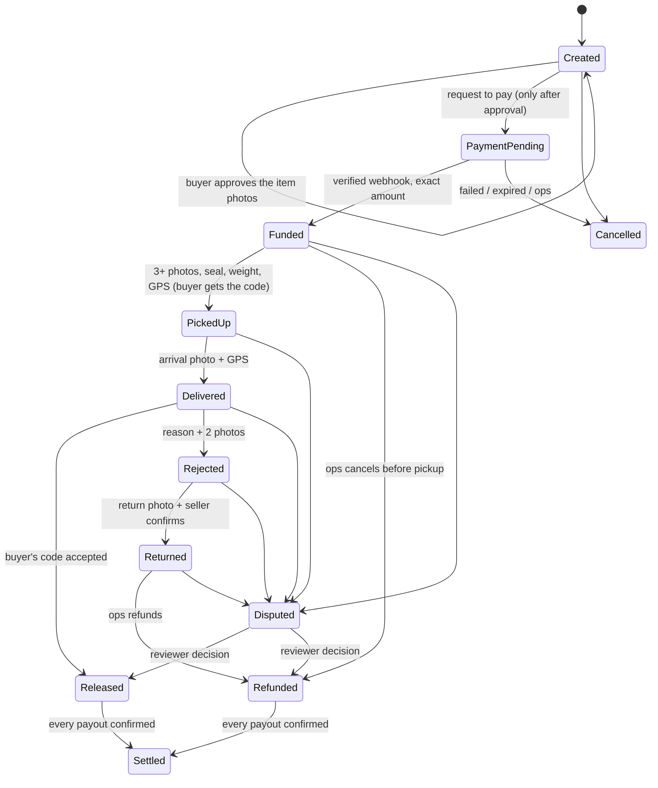

# Courier-Backed Escrow

> **Full guide: [docs/GUIDE.md](docs/GUIDE.md)** (how to run it, how to use it, how it works, troubleshooting).

A trust layer for social-media and informal commerce in Malawi. The buyer pays into escrow, a **courier acts as the verifier**
at pickup and at the door, and the money is released only when the buyer gives the courier a one-time code. Every kwacha is a
ledger entry; nothing is ever edited, only posted.

This is the engine for the MVP in *Courier-Backed Escrow: System Design (MVP), draft v0.1*: .NET 8 modular monolith, PostgreSQL,
OneKhusa for collections and payouts, a courier web app (PWA) and an ops console.

## What is in the box

| Design section | Where it lives |
|---|---|
| Order state machine (12 states, proof guards, optimistic concurrency, `client_event_id`) | `Domain/Escrow.cs`, `Domain/OrderEvent.cs` |
| Double-entry, append-only ledger, posting rules per event | `Domain/Ledger/`, guards in `Infrastructure/Persistence/LedgerGuards.cs` |
| OneKhusa collections, webhooks (HMAC-SHA512), payouts, idempotency keys, token cache | `Infrastructure/OneKhusa/` |
| Webhook inbox (raw payload stored first, deduplicated, retried by a worker) | `Application/BackgroundServices.cs` (`WebhookService`) |
| Collections: intent, request to pay, poll fallback, expiry | `Application/CollectionService.cs` |
| Payouts: queued → submitted → confirmed, retries, `NEEDS_REVIEW`, `SETTLED` only when all confirmed | `Application/PayoutService.cs` |
| OTP (HMAC, 24 h, 5 attempts, lockout to ops) and proof of handoff (photos hashed by the server, GPS, seal) | `Domain/Handoff.cs`, `Application/HandoffService.cs` |
| Disputes with a 48 h window and a written, reviewer-only decision | `Application/DisputeService.cs` |
| SMS notifications from a queue, OTP encrypted at rest and blanked after sending | `Application/SmsTemplates.cs`, `NotificationDispatcher` |
| Daily reconciliation and the alert strip | `ReconciliationService`, `AlertsService` |
| Roles, courier phone + PIN with device binding and lockout, audit trail | `Api/Auth.cs`, `Application/CourierService.cs` |
| Transactional outbox → RabbitMQ (optional) | `Infrastructure/Messaging/` |
| Courier web app (PWA, offline queue) | `Api/wwwroot/courier/` served at `/courier-app/` |
| Admin portal | `CourierEscrow.Web` (Blazor Server) |

## Initial login (development)

| Where | Username | Password |
|---|---|---|
| Ops console (first administrator) | `admin` | `Nexa-dev-2026` |
| Courier web app (demo courier) | phone `0999 123 456` | PIN `1234` |

The console asks you to choose your own password on first sign-in. These values come from `appsettings.Development.json` and are for development only.

## Run it

```bash
docker compose up -d                              # PostgreSQL + RabbitMQ
dotnet run --project src/CourierEscrow.Api        # http://localhost:5080  (Development: mock provider, throwaway keys, schema auto-created)
dotnet run --project src/CourierEscrow.Web        # http://localhost:5090  (ops console)
./scripts/demo.sh                                 # one order, start to SETTLED, over HTTP
dotnet test                                       # 155 tests
node tests/courier-app/sync.test.js               # the courier app's offline queue
(cd tests/buyer-page && npm i && npm test)        # the buyer page: approve photos, pay, hand-over (jsdom)
```

* Courier app: open `http://localhost:5080/courier-app/` on a phone (or a phone-sized browser window). Create a courier in the console first (Couriers → Add).
* In Development the SMS sender writes messages to the API log, so the buyer's code is in the log. The console has "Simulate payment" and "Simulate success" buttons that play the provider's webhooks.
* **The buyer approves the item photos first, and only then is payment requested.** The order is created with three listing photos. The buyer's page (`/t/<token>`) shows them and asks *Is this the item you are buying?* Tapping **Yes** records the approval and requests the payment in one step; the page then shows the account number to pay, a countdown and a copy button. Until they approve, the API refuses to start a payment (HTTP 422) and the console shows "Waiting for the buyer". If the buyer says **No**, no payment starts, the order is flagged for ops, and they can still approve later. If the payment provider is down at the moment of approval, the approval is kept and the page offers *Get my payment details*; tapping it again resumes the same payment request (same idempotency reference, so nobody is charged twice).
* **Walk a whole order in a browser, no phone needed (Development only):** open an order in the console. "Buyer link" opens the buyer's page. Then: *Simulate buyer approval* (plays the buyer's **Yes**), *Simulate payment* (the provider's success webhook, so the order becomes `Funded` and the ledger shows the escrow entry), *Simulate courier pickup* (issues and texts the buyer's code), *Simulate courier arrival*, *Simulate buyer accepting* (runs the real code check, so the ledger, payouts and SMS behave exactly as for a real hand-over), then *Simulate success* on each payout to reach `Settled`. The same buttons appear on the buyer page under "Developer tools". The "Test SMS inbox" on the order shows every message sent, including the buyer's code. Needs `Web:DevTools=true` (set in `appsettings.Development.json`).
* **Courier enters the code (Development only):** open `http://localhost:5080/dev/handover` (or "Open courier code screen" on the order in the console), paste the buyer link and bring the order to the door. The page shows a **courier link** to copy and send to the courier. The courier types the 6 digits the buyer gives them. The check is real: the code is compared with its stored hash, a wrong try is counted (five lock the order and flag it for ops), and the right one releases the escrow, posts the ledger entries and queues the seller and courier payouts. The same screen then plays the payment provider (**Send payouts and mark them paid**) so both payouts confirm and the order reaches `Settled`. "Look in the test SMS inbox" shows the code the system really texted the buyer. The order event records `courier:<id>`.
* Swagger is not included; the API map is below.

Sign in to the console with the first administrator, created automatically on first start: in development `admin` / `Nexa-dev-2026` (throwaway, from `appsettings.Development.json`). You are asked to choose your own password straight away. See **Users and sign-in** below.

For scripts only (`scripts/demo.sh`), `appsettings.Development.json` also has throwaway machine keys: `dev-admin-key` (ops_admin), `dev-ops-key` (ops_agent), `dev-finance-key` (finance), sent as `X-Api-Key`.

## Users and sign-in

- **First administrator.** When there are no staff users, the API creates one on startup (`Auth:BootstrapAdmin`: `Username`, default `admin`, and `Password`). With no password configured, a random one is generated and written to the log **once**. Either way the account must change its password at first sign-in.
- **Roles.** `ops_agent` (orders), `finance` (payouts, reconciliation), `ops_admin` (refunds, disputes, audit, users).
- **Sign-in.** `POST /auth/login` with username and password returns a token valid for `Auth:StaffTokenLifetimeHours` (default 8). The console keeps it in an encrypted, HttpOnly cookie that expires with it.
- **Revocation.** The account is checked on every request. Disabling a user, changing their role, resetting their password, or the user changing their own password signs out every existing session immediately.
- **Lockout.** 5 wrong passwords lock the account for 15 minutes; an administrator can unlock it. Sign-in is also rate limited per client address.
- **Passwords.** PBKDF2-SHA256 (210,000 iterations), at least 5 characters (anything you like: letters, numbers, symbols), at most 128.
- **Guard rails.** You cannot disable or demote yourself, and the last active administrator cannot be disabled or demoted.
- **Managing people.** Console page **Users** (administrators only), or `GET/POST /admin/users` and `/admin/users/{id}/{profile|role|status|reset-password|unlock}`. Every change is in the audit trail; passwords never are.
- **Existing databases.** `staff_users` is created by `LedgerGuards.Upgrades` (development `AutoInit`). In production, ship that statement in your migration before deploying, or the first-administrator step logs an error.
- **API keys** (`Auth:StaffKeys`) still work for scripts and CI. None are configured by default; do not use them for people.

## How an order moves



A released order can never be disputed. A dispute that pays the seller ends in `Released`, one that only pays the buyer/courier ends in `Refunded`; both then settle when their payouts confirm.

### The money (the design's worked example, in the tests)

Item K300,000 + delivery K8,000, platform fee 2% **of the item** (fixed on the order at creation).

| Event | Debit | Credit |
|---|---|---|
| Buyer pays | provider clearing 308,000 | escrow 308,000 |
| Code accepted | escrow 308,000 | seller payable 294,000 · platform revenue 6,000 · courier payable 8,000 |
| Rejected, returned, refunded | escrow 308,000 | buyer refundable 300,000 · courier payable 8,000 |
| Payout confirmed | seller payable 294,000 (+ provider fee expense) | provider clearing |

Amounts are `long` tambala (1/100 kwacha), never floating point. The books balance when
`provider balance = escrow + payables + platform revenue − provider fees`; the dashboard shows that check and reconciliation enforces it.

## What protects the money

* **Idempotency everywhere.** Collections and payouts carry a stable reference used as the provider's `X-Idempotency-Key`; a retry after a timeout cannot charge or pay twice. Courier events carry a `clientEventId` (unique per order in the database). Ledger postings have a unique idempotency key. Webhook events are unique by event key.
* **One transaction per change.** State, order events, ledger rows, payouts, SMS and outbox messages commit together.
* **The database enforces the rules too.** Triggers reject UPDATE/DELETE on ledger, order events and audit log, and reject any ledger transaction that does not balance.
* **Money is never trusted from the client.** A wrong amount does not fund the order; it is flagged. A payment that arrives after cancellation is flagged for a manual refund instead of being swallowed.
* **Evidence.** Photos go to storage through a signed, expiring link; the *server* computes the SHA-256. GPS and server time are stored with each proof.
* **OTP.** Six digits, keyed HMAC per order, never stored; expires after 24 h; 5 attempts, then the order is flagged for ops and even the right code stops working until ops reissue it. A retried wrong attempt is not counted twice.
* **Secrets.** Phone numbers are masked in the admin API and logs. The OTP in a queued SMS is AES-GCM encrypted until sent, then blanked. PINs use PBKDF2. Provider secrets come from configuration, never the repo.

## OneKhusa

Set `Payments:Provider=OneKhusa` and supply (environment variables or a secret store):

```
OneKhusa__Environment=Sandbox            OneKhusa__ApiKey=...            OneKhusa__ApiSecret=...
OneKhusa__OrganisationId=...             OneKhusa__MerchantAccountNumber=...
OneKhusa__CapturedBy=you@company.com     OneKhusa__WebhookSecret=...
OneKhusa__AirtelConnectorId=...          OneKhusa__TnmConnectorId=...
```

Find the connector ids with `GET /admin/provider/connectors` (finance role). Point OneKhusa's webhooks at `POST /webhooks/onekhusa`;
the API verifies `X-OneKhusa-Webhook-Signature` (HMAC-SHA512 over the raw body) and reads the event from `X-OneKhusa-Webhook-Event`.

**Important:** a OneKhusa request-to-pay returns a *timed account number* the buyer pays into (bank or mobile money), not a push prompt on the buyer's phone. The SMS tells the buyer the account number, amount and deadline.

What I could not confirm from the public docs, so the adapter reports "unknown" rather than guessing: a status endpoint for collections (so polling cannot yet rescue a lost collection webhook; expiry still protects you), the provider balance (the clearing-balance check is skipped), and the collections statement. Ask OneKhusa for these, plus the settlement/trust-account question in design section 6. Everything has been tested against a fake OneKhusa server; **nothing has been run against the real sandbox yet.**

## API map

```
Courier   POST /courier/login                      GET /courier/jobs[/{id}]
          POST /courier/uploads/presign            PUT /uploads/{id}?exp&sig   (signed link, photo bytes)
          POST /courier/orders/{id}/events         type = pickup | arrived | otp | reject | return | unreachable | dispute
Admin     GET  /admin/summary /alerts /orders[/flagged] /orders/{id} /payouts /disputes /ledger /reconciliation /couriers /audit
          POST /admin/orders  /orders/{id}/payment|cancel|refund|otp/reissue|clear-flag|dispute
          POST /admin/disputes/{id}/decide   /payouts/{id}/retry   /reconciliation/run   /couriers[/{id}/reset-device|status]
Public    GET  /track/{token}  /track/{token}/photos/{proofId}      POST /track/{token}/confirm-product  /track/{token}/decline-product
          POST /webhooks/{provider}      GET /health
Dev only  GET /dev/handover (screen)  GET /dev/handover/{token}  POST /dev/handover/{token}/code {code}  POST /dev/handover/{token}/payouts
          POST /dev/approve/{orderId}  /dev/pay/{orderId}  /dev/pay-by-token/{token}  /dev/pickup/{token}  /dev/deliver/{token}  /dev/accept/{token}
          POST /dev/payout-success/{reference}?amount=   GET /dev/sms[?escrowId]  /dev/ping
```

Roles: `ops_agent` creates orders and handles day-to-day; `ops_admin` also refunds, decides disputes and manages couriers; `finance` retries payouts and runs reconciliation. Couriers use a signed token from `/courier/login`.

## Configuration

| Setting | Purpose |
|---|---|
| `ConnectionStrings:Escrow` | PostgreSQL |
| `Payments:Provider` | `Mock` (default) or `OneKhusa` |
| `Escrow:PlatformFeeBps` | fee on the item, default 200 (2%); frozen on each order |
| `Escrow:OtpSecret`, `Auth:TokenSecret`, `Security:DataKey`, `Storage:SigningSecret` | **must be set from a secret store outside Development** |
| `Auth:BootstrapAdmin` | first administrator (`Username`, `Password`, `DisplayName`) |
| `Auth:StaffTokenLifetimeHours` | staff session length (default 8) |
| `Auth:StaffKeys` | optional machine API keys for scripts and CI |
| `Sms:Provider` | `Log` (default) or `Http` (generic aggregator; adjust the payload in `SmsSenders.cs`) |
| `Workers:Enabled`, `RabbitMq:Enabled`, `Database:AutoInit` | background workers in-process, event publishing, create schema on start (dev) |

## What was and was not verified

Verified here (a sandbox with .NET 8 but **no NuGet access**, so the tests ran through a small xunit stand-in; they are plain xunit and should run as-is):

* **155 tests pass**: state machine, buyer approval before payment (including a provider outage and a decline), the dev walk-through to `SETTLED`, ledger postings, settlement math, OTP, payouts (retry, review, reversal), disputes, collections (wrong amount, duplicates, late payment, expiry, polling), handoff, webhooks, reconciliation, alerts, courier sign-in, encryption, signed links, and the OneKhusa adapter against a fake HTTP server.
* **The whole lifecycle over HTTP** (`scripts/demo.sh`): API, auth, JSON, courier events with replay, photo upload, workers, payouts, settlement, reconciliation, with the in-memory ports.
* The Blazor console compiles and its routes load; the courier app's offline-queue logic passes its node tests; the buyer page passes its jsdom walk-through (approve, pay, pickup, arrival, accept, retry after an outage). **Not looked at in a real browser here, so check the new look on a phone-sized window.**

**Not run, because the sandbox could not reach NuGet, Postgres or RabbitMQ:** the EF Core mapping, the repositories, the SQL triggers, the outbox publisher against a real broker, and the console's interactive behaviour in a browser. That code (`Infrastructure/Persistence`, `Messaging`) is the first place to look if `dotnet run` complains. Expect to fix small things there. The domain and service logic it feeds is covered by the tests above.

## Where this differs from the design PDF (and why)

* Provider credentials live in configuration/a secret store, not in a database table (design §13: secrets in a secret store).
* `RETURNED → REFUNDED` happens when ops *decide* the refund (ledger posted, payouts queued); the order then reaches `SETTLED` when payouts confirm, which is the design's own rule for `REFUNDED → SETTLED`.
* A funded order can be cancelled and refunded in full before pickup (the WhatsApp copy in the mockups promises this); the PDF's table only cancels before payment.
* Provider fee on a payout is booked when the payout confirms; the collection fee when the collection confirms (design decision 6: platform absorbs).
* Payment failure or expiry cancels the order (as in the PDF). The mockup's "Pay again" would need a new order.
* The PDF's `dispute_notes` table is not built; a decision carries one written reason.

## Not built (deliberately, per the MVP scope or because it needs your input)

USSD, the Flutter offline-first app, reputation scores, multiple providers, seller credit, automated dispute decisions; the later screens' multi-company / hub / multi-leg parcel model and WhatsApp channel; MFA and a real identity provider for staff; maker-checker manual ledger adjustments; pickup-SLA and inspection-window timers (design decision 4 says no auto-release); S3/Azure object storage (the `IObjectStorage` port has a local-disk implementation); EF migrations (the schema is created by `EnsureCreated` plus `LedgerGuards.Sql` in development, so generate migrations and ship that SQL as one before production); Testcontainers integration tests.

## Before real money

1. Run it against Postgres and fix whatever the EF code surfaces; generate migrations.
2. OneKhusa sandbox end to end, then settle design §6 (trust account, payout limits, fees, statement endpoint).
3. Real secrets from a secret store; remove the dev keys; set `Dev:Endpoints` off (the default).
4. Replace staff API keys with an identity provider + MFA; put the API behind HTTPS.
5. A real SMS aggregator and S3-compatible storage; backups with restore tests.
6. Review the fee default (2%) and the open decisions in design §17.


## Licence

Licensed under the [Apache License, Version 2.0](LICENSE). You may use, modify and distribute it, including commercially, under the terms of that licence. It is provided "as is", without warranty of any kind.

**Status: not audited.** The payment code has not been run against the real OneKhusa sandbox or a production database, and has had no security review. Do not use it with real money until you have done the steps under "Before real money" above and had it reviewed.
